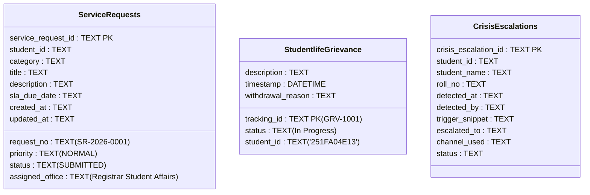
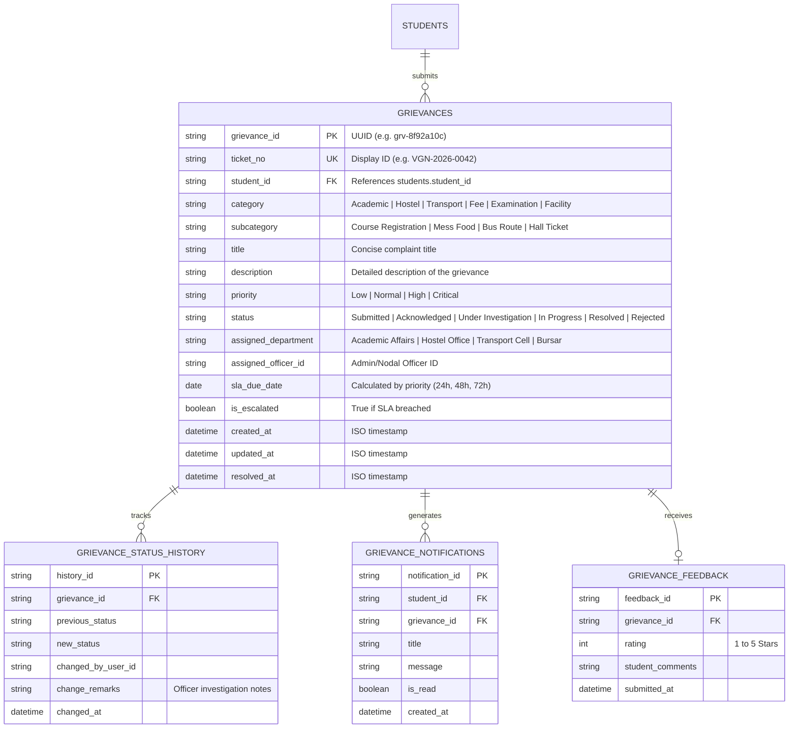

# VIGNAN-AI: Complaint & Grievance System Audit Report

**Date:** November 5, 2026  
**Project:** VIGNAN-AI (Autonomous University AI Helpdesk & Grievance System)  
**Author:** Senior Systems Architect & Database Auditor  
**Classification:** Phase 0 Grievance Workflow Audit  
**Status:** **AUDIT COMPLETE — READ-ONLY PHASE (NO RECORDS MODIFIED OR MIGRATED)**  

---

## 1. Executive Summary

A core pillar of Problem Statement 8 (PS8) is a **centralized, tracked, and automatically categorized student grievance resolution system**.

Our inspection reveals that grievance handling in VIGNAN-AI is currently **split across two disconnected database tables and multiple mock frontend arrays**:
1. **`service_requests` Table:** Used by the FastAPI backend (`routes_services.py`) and AI chatbot agent tools. Contains **374 records**, of which 373 are in `SUBMITTED` status and were generated as synthetic artifacts during benchmark test runs.
2. **`studentlife_grievance` Table:** Used exclusively by the administrative dashboard endpoints in [`routes_admin.py`](file:///c:/Users/modug/OneDrive/Desktop/VIGNAN-AI/VIGNAN-AI/VIGBOT-main/BACKEND/app/api/routes_admin.py). Contains only **3 static demo records** (`GRV-1001`, `GRV-1002`, `GRV-1003`).
3. **Critical Disconnect:** Because the admin dashboard queries `studentlife_grievance` while the student helpdesk inserts into `service_requests`, **complaints filed by students through the helpdesk never appear on the administrator's dashboard**.

This report provides the full forensic analysis of both systems and specifies the unified schema required for Phase 2.

---

## 2. Table-by-Table Forensic Audit



### 2.1 The `service_requests` Table (`database/vigbot.db`)

* **Schema:**
  ```sql
  CREATE TABLE service_requests (
      service_request_id TEXT PRIMARY KEY,
      request_no TEXT,
      student_id TEXT,
      category TEXT,
      title TEXT,
      description TEXT,
      priority TEXT,
      status TEXT,
      assigned_office TEXT,
      sla_due_date TEXT,
      created_at TEXT,
      updated_at TEXT
  );
  ```
* **Total Records:** **374 rows**
* **Status Distribution:**
  * `SUBMITTED`: **373 rows** (99.7%)
  * `READY_FOR_COLLECTION`: **1 row** (0.3% — `SR-2026-0001`, a seed record for Asha Reddy)
* **Category Breakdown:**
  * `BONAFIDE_CERTIFICATE`: **220 rows** (58.8%)
  * `ID_CARD_REPLACEMENT`: **105 rows** (28.1%)
  * `GRIEVANCE_LODGED`: **21 rows** (5.6%)
  * `OTHER`: **20 rows** (5.3%)
  * `MENTOR_APPOINTMENT`: **7 rows** (1.9%)
  * `Test`: **1 row** (0.3%)
* **Data Provenance:**
  * **Synthetic Benchmark Data:** 373 of the 374 rows were generated during automated evaluation runs on September 12, 2026. Every one of these 373 records is linked to student ID `cccccccc-0000-0000-0000-000000000001` (`24CSE001` - Asha Reddy).
* **Limitations Identified:**
  * **Hardcoded Department:** In [`database.py`](file:///c:/Users/modug/OneDrive/Desktop/VIGNAN-AI/VIGNAN-AI/VIGBOT-main/BACKEND/app/database.py#L488), the `assigned_office` is hardcoded to `"Registrar Student Affairs"` for all submissions, regardless of whether the category is Hostel, Academic, Transport, or Examination.
  * **Fixed SLA:** The SLA is hardcoded to `today + 3 days` with no differentiation between urgent issues (e.g. water leakage) and routine requests (e.g. transcript issuance).

### 2.2 The `studentlife_grievance` Table (`database/vigbot.db`)

* **Schema:**
  ```sql
  CREATE TABLE studentlife_grievance (
      tracking_id TEXT PRIMARY KEY,
      description TEXT NOT NULL,
      status TEXT NOT NULL,
      timestamp DATETIME DEFAULT CURRENT_TIMESTAMP,
      withdrawal_reason TEXT,
      student_id TEXT DEFAULT '251FA04E13'
  );
  ```
* **Total Records:** **3 rows**
* **Record Contents:**
  1. `GRV-1001`: *"Wi-Fi extremely slow in Block B library section"* | Status: `In Progress` | Student: `251FA04E13`
  2. `GRV-1002`: *"Water cooler on 3rd floor N block is dispensing hot water"* | Status: `Pending` | Student: `251FA04E13`
  3. `GRV-1003`: *"Stray dogs near the boys hostel entrance at night"* | Status: `Resolved` | Student: `OTHER_STU`
* **Data Provenance:**
  * **Static Seed Demo Rows:** These 3 records are the identical mock strings found in [`FRONTEND/src/data/adminMockData.ts`](file:///c:/Users/modug/OneDrive/Desktop/VIGNAN-AI/VIGNAN-AI/VIGBOT-main/FRONTEND/src/data/adminMockData.ts#L1-L5).
* **Limitations Identified:**
  * Lacks title, category, priority, assigned office, resolution notes, and SLA deadlines.
  * Cannot link to official student identity UUIDs (uses loose string `'251FA04E13'`).

### 2.3 The `crisis_escalations` Table (`database/vigbot.db`)

* **Total Records:** **232 rows**
* **Contents:** Generated by the Step 9 distress keyword guardrail. Every row contains suicidal or severe distress snippets (e.g. *"I am so overwhelmed by these fees and my attendance. I feel like ending my life..."*) triggered during benchmark testing for `24CSE001` (Asha Reddy).
* **Status:** All records are marked `PAGE_SENT` or `ESCALATED` to `Agent 66 (24/7 Student Wellbeing Helpline)`.
* **Classification:** Retained as safety compliance verification records for distress intervention.

---

## 3. Evaluation of Grievance Capabilities Against PS8

| Capability Requirement | Current Status | Forensic Finding | Evidence / Code Link |
| :--- | :--- | :--- | :--- |
| **Historical Complaints** | **Present (Demo Only)** | 374 service requests + 3 grievances exist; all are test/demo artifacts. | `service_requests` (374), `studentlife_grievance` (3) |
| **Student Identity Linkage** | **Partially Implemented** | `service_requests` links to `student_id`. However, students lack a UI view showing all their historical grievances in one place. | [`routes_services.py:L19-L22`](file:///c:/Users/modug/OneDrive/Desktop/VIGNAN-AI/VIGNAN-AI/VIGBOT-main/BACKEND/app/api/routes_services.py#L19-L22) |
| **Automatic Categorization** | **Not Implemented** | Category is selected manually by the user or hardcoded; no NLP text classifier analyzes the complaint body. | [`database.py:L488`](file:///c:/Users/modug/OneDrive/Desktop/VIGNAN-AI/VIGNAN-AI/VIGBOT-main/BACKEND/app/database.py#L488) |
| **Automatic Department Assignment** | **Not Implemented** | `assigned_office` is hardcoded to `"Registrar Student Affairs"` for 100% of rows. | [`database.py:L488`](file:///c:/Users/modug/OneDrive/Desktop/VIGNAN-AI/VIGNAN-AI/VIGBOT-main/BACKEND/app/database.py#L488) |
| **Status History Recording** | **Missing** | Neither table has a status history audit trail. When status changes from `SUBMITTED` to `RESOLVED`, the previous state and timestamp are overwritten. | Missing `grievance_status_history` table |
| **Student Complaint Tracking** | **Partially Implemented** | `GET /api/v1/service-requests` returns the student's requests, but students cannot view departmental progress comments or resolution explanations. | Missing tracking timeline UI |
| **Database-Backed Notifications** | **Missing** | Notifications in the frontend are driven by a static TypeScript array (`INITIAL_NOTIFICATIONS`); no notification is generated when a ticket status updates. | [`notifications.ts`](file:///c:/Users/modug/OneDrive/Desktop/VIGNAN-AI/VIGNAN-AI/VIGBOT-main/FRONTEND/src/data/notifications.ts) |
| **Automated SLA Escalation** | **Missing** | No cron job or background scheduler checks `sla_due_date` against current time to trigger automated escalations for overdue tickets. | No active background scheduler |

---

## 4. Proposed Unified Complaint System Architecture

To resolve the disconnection between `service_requests` and `studentlife_grievance`, Phase 2 will introduce a **single, unified grievance schema**:



### Key Architectural Benefits
1. **Single Source of Truth:** Unifies helpdesk service requests and administrative grievance workflows into a single table.
2. **Full Audit Trail:** `GRIEVANCE_STATUS_HISTORY` records every state transition with officer remarks and timestamps.
3. **Database-Driven Notifications:** Any status transition automatically generates an unread notification in `GRIEVANCE_NOTIFICATIONS`.
4. **Student Feedback Loop (PS8 Item 9):** `GRIEVANCE_FEEDBACK` captures student satisfaction ratings on resolved issues.
5. **Preservation Guarantee:** Existing rows in `service_requests` and `studentlife_grievance` will remain intact; Phase 2 will execute a non-destructive schema migration.

