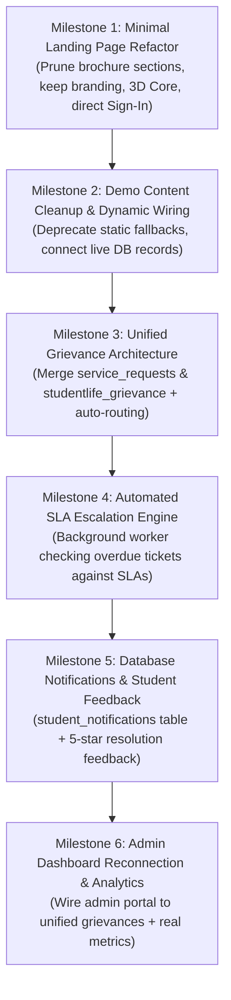

# VIGNAN-AI: Next Phase Implementation Plan & Architecture Roadmap

**Date:** November 5, 2026  
**Project:** VIGNAN-AI (Autonomous University AI Helpdesk & Grievance System)  
**Author:** Senior Full-Stack Lead, AI Systems Architect & Cybersecurity Lead  
**Classification:** Strategic Engineering Plan  
**Status:** **AWAITING USER APPROVAL BEFORE EXECUTION**  

---

## 1. Executive Summary & Purpose

This document defines the actionable, step-by-step engineering roadmap to transition VIGNAN-AI from its current prototype state into a production-grade, 100% PS8-compliant system.

The core objective is to deliver an **AI-powered student helpdesk and grievance resolution system specifically for the institution's existing students whose records are available in approved institutional datasets**.

All tasks are organized into **6 sequential implementation milestones**, governed by strict non-destructive constraints and verification gates.



---

## 2. Milestone Breakdown & Technical Work Packages

### Milestone 1: Minimal Landing Page Refactor
**Goal:** Deliver a clean, minimal public landing page containing **ONLY** VIGNAN-AI branding, the Three.js 3D visual, a concise title and description, Student Sign In, and Admin Sign In.

* **Task 1.1: Prune Unnecessary Public Sections from [`LandingPage.tsx`](file:///c:/Users/modug/OneDrive/Desktop/VIGNAN-AI/VIGNAN-AI/VIGBOT-main/FRONTEND/src/components/landing/LandingPage.tsx):**
  * Remove Feature Cards Grid (L318–L369).
  * Remove Interactive Live Preview component (`InteractiveLivePreview.tsx`).
  * Remove 4-Step How It Works Grid (L371–L399).
  * Remove About Narrative (L401–L443).
  * Remove Student Support Quadrants & Promotional Blue Banner (L445–L504).
  * Remove dead navigation anchor links (`#features`, `#how-it-works`, etc.).
  * Remove roadmap status badges ("Available", "Planned").
* **Task 1.2: Refactor Hero & Authentication Layout:**
  * Keep the responsive navigation bar with Vignan Foundation branding, Language Selector, and "Student Sign In".
  * Retain the Three.js 3D AI Core (`ThreeAiCore.tsx`) in the hero section.
  * Update copy to institutional focus:
    * **Title:** *"Your Campus. Connected by Intelligence."*
    * **Subtitle:** *"AI-powered student helpdesk and grievance resolution system for Vignan Foundation for Science, Technology and Research (VFSTR)."*
  * Place two prominent, un-distracted call-to-action buttons:
    * **Primary:** `[ Student Sign In ]` (triggers login / account activation modal).
    * **Secondary:** `[ Nodal Officer / Admin Portal ]` (routes to `/admin/login`).
* **Task 1.3: Verify Dashboard & Auth Gateways:**
  * Ensure the authenticated student dashboard, chatbot, and profile tools remain 100% accessible behind the login gate.

---

### Milestone 2: Demo Content Cleanup & Dynamic Wiring
**Goal:** Deprecate static demo mock arrays and bind the student dashboard directly to verified database queries.

* **Task 2.1: Deprecate Frontend Mock Fallbacks:**
  * Replace static `CURRENT_STUDENT` fallback in `src/data/student.ts` with authenticated session state.
  * Deprecate static `ATTENDANCE_DATA`, `MARKS_DATA`, and `FEES_DATA` in favor of backend API endpoints:
    * `GET /api/v1/conversations/dashboard`
    * `GET /api/v1/auth/me`
* **Task 2.2: Decouple Client Roster Bundle:**
  * Ensure `students-db.ts` (77,663 lines) is never loaded in client JavaScript bundles, protecting student roster privacy.
* **Task 2.3: Rebrand Developer Identifiers:**
  * Replace developer group references (`Group 13`, `VIGBOT`, `Agent NN`) with official university office designations (*VFSTR Student Affairs*, *Controller of Examinations*, *VIGNAN-AI*).

---

### Milestone 3: Unified Grievance & Service Request Architecture
**Goal:** Merge the fragmented `service_requests` (374 rows) and `studentlife_grievance` (3 rows) tables into a single, cohesive, production-grade schema.

* **Task 3.1: Create Unified `grievances` Table:**
  ```sql
  CREATE TABLE IF NOT EXISTS grievances (
      grievance_id TEXT PRIMARY KEY,
      ticket_no TEXT UNIQUE NOT NULL,
      student_id TEXT NOT NULL,
      category TEXT NOT NULL,
      title TEXT NOT NULL,
      description TEXT NOT NULL,
      priority TEXT DEFAULT 'NORMAL',
      status TEXT DEFAULT 'SUBMITTED',
      assigned_department TEXT NOT NULL,
      assigned_officer TEXT,
      sla_due_date TEXT NOT NULL,
      is_escalated INTEGER DEFAULT 0,
      created_at TEXT NOT NULL,
      updated_at TEXT NOT NULL,
      resolved_at TEXT
  );
  ```
* **Task 3.2: Create `grievance_status_history` Audit Table:**
  ```sql
  CREATE TABLE IF NOT EXISTS grievance_status_history (
      history_id TEXT PRIMARY KEY,
      grievance_id TEXT NOT NULL,
      previous_status TEXT,
      new_status TEXT NOT NULL,
      changed_by TEXT NOT NULL,
      remarks TEXT,
      changed_at TEXT NOT NULL,
      FOREIGN KEY (grievance_id) REFERENCES grievances(grievance_id)
  );
  ```
* **Task 3.3: Implement Automated Semantic Categorization & Department Routing:**
  * In `BACKEND/app/agent/universal_nlu.py` and `routes_services.py`, implement automated department assignment:
    * `ACADEMIC` -> `Dean Academic Affairs (DAA)` (SLA: 48h)
    * `EXAMINATION` -> `Controller of Examinations (CoE)` (SLA: 24h)
    * `HOSTEL` -> `Chief Warden & Hostel Office` (SLA: 24h)
    * `TRANSPORT` -> `Transport Coordinator` (SLA: 48h)
    * `FEES` -> `Bursar Accounts Division` (SLA: 72h)
    * `FACILITY` -> `Estate Maintenance Cell` (SLA: 48h)

---

### Milestone 4: Automated SLA Escalation Engine
**Goal:** Deliver hands-free, automated escalation of unresolved complaints exceeding SLA targets (PS8 Item 7).

* **Task 4.1: Background Escalation Worker:**
  * Implement an asynchronous scheduler running every 60 minutes in the FastAPI backend.
  * Identifies tickets where `status NOT IN ('RESOLVED', 'REJECTED')` and `datetime('now') > sla_due_date`.
* **Task 4.2: Tiered Escalation Routing:**
  * **Level 1 (SLA breached):** Escalate from assigned officer to Department HOD; set `is_escalated = 1`; log to `grievance_status_history`.
  * **Level 2 (+48h post breach):** Escalate to Dean Student Welfare / Registrar.
* **Task 4.3: Automated Alerts:**
  * Generate an urgent notification in the admin dashboard and log escalation events.

---

### Milestone 5: Database-Backed Notifications & Student Feedback Loop
**Goal:** Replace static notifications with live database events and provide 5-star resolution feedback (PS8 Items 6 & 9).

* **Task 5.1: Create `student_notifications` Schema & APIs:**
  * Schema: `notification_id`, `student_id`, `title`, `message`, `priority`, `read_status`, `created_at`.
  * API: `GET /api/v1/notifications`, `POST /api/v1/notifications/{id}/read`.
  * Trigger: Status updates in `grievances` automatically insert a notification row for the affected student.
* **Task 5.2: Create `grievance_feedback` Schema & Rating UI:**
  * Schema: `feedback_id`, `grievance_id`, `student_id`, `rating` (1–5), `comments`, `created_at`.
  * API: `POST /api/v1/service-requests/{ticket_no}/feedback`.
  * Frontend: Prompt student for feedback as soon as a grievance transitions to `RESOLVED`.

---

### Milestone 6: Admin Dashboard Reconnection & Real Analytics
**Goal:** Reconnect the Nodal Officer / Admin portal to the unified grievance database with real SLA tracking and resolution analytics (PS8 Item 10).

* **Task 6.1: Point Admin API to Unified Table:**
  * Refactor [`BACKEND/app/api/routes_admin.py`](file:///c:/Users/modug/OneDrive/Desktop/VIGNAN-AI/VIGNAN-AI/VIGBOT-main/BACKEND/app/api/routes_admin.py) to read and update `grievances` instead of the 3-row `studentlife_grievance` table.
* **Task 6.2: Real Dynamic Analytics:**
  * Compute real statistics dynamically:
    * Total tickets received, resolved, pending, escalated.
    * Average resolution time per department.
    * Departmental SLA compliance percentage.
* **Task 6.3: Exportable Nodal Reports:**
  * Enable PDF/CSV export of weekly grievance resolution reports for university leadership.

---

## 3. Strict Rules & Preservation Commitments

1. **Zero Record Deletions:** No student records, attendance rows, marks, or historical test tables will be purged during implementation.
2. **Zero Unauthorized Neon Modifications:** All changes will be executed and validated against local SQLite (`database/vigbot.db`); cloud Neon deployment will occur only upon explicit written instruction.
3. **Preservation of Existing Dashboards:** The authenticated student portal, timetable views, attendance monitors, and AI chatbot will remain fully operational.
4. **No Synthetic Credentials:** No fake passwords or demo shortcuts will be created.

---

## 4. Verification & Testing Protocol

Each milestone must pass strict verification gates before proceeding:
1. **Frontend Verification:** `next build --webpack` must compile with 0 TypeScript and 0 ESLint errors.
2. **Backend Verification:** All FastAPI endpoints must pass automated unit test suites (`pytest`).
3. **Security Check:** Row-Level Security and Admin Role Authorization must remain 100% enforced across all new endpoints.
4. **Browser Verification:** Visual inspection confirming the minimal landing page renders smoothly across desktop, tablet, and mobile breakpoints.

---

**Approval Request:**  
Phase 0 audit is complete. Awaiting user approval to initiate **Milestone 1: Minimal Landing Page Refactor** and **Milestone 2: Demo Content Cleanup**.

