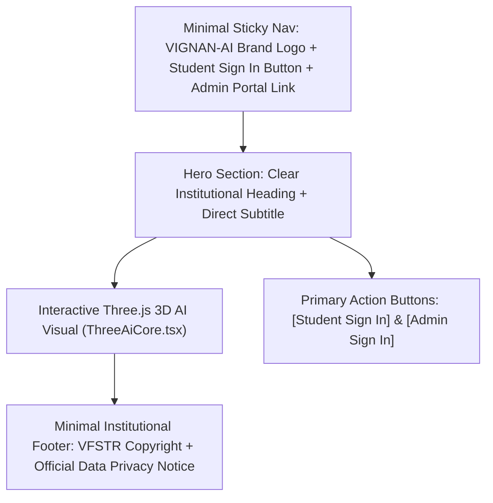
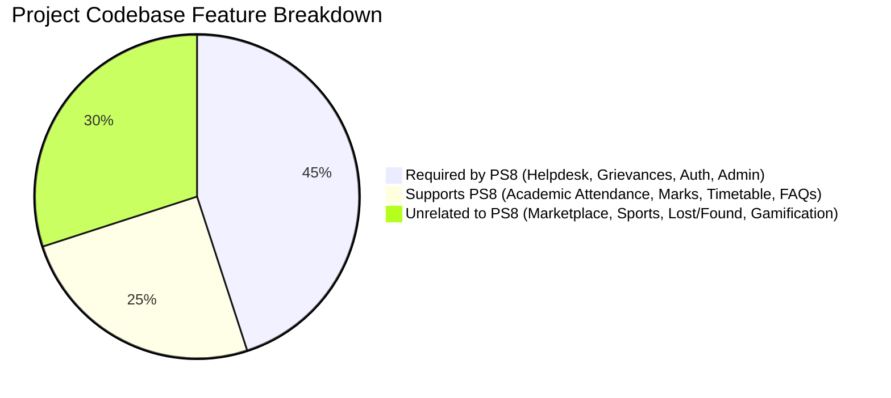

# VIGNAN-AI: Project Cleanup & Demo Content Audit Report

**Date:** November 5, 2026  
**Project:** VIGNAN-AI (Autonomous University AI Helpdesk & Grievance System)  
**Author:** Senior Software Architect, Security Auditor & Full-Stack Lead  
**Classification:** Phase 0 Architecture Audit & Pre-Remediation Specification  
**Status:** **AUDIT COMPLETE — READ-ONLY PHASE (NO CODE/DB MODIFICATIONS)**  

---

## 1. Executive Summary & Core Mission Alignment

VIGNAN-AI is an **AI-powered student helpdesk and grievance resolution system specifically engineered for the institution's existing students whose records exist in approved institutional datasets**. It is **not** a general marketing portal, social platform, or promotional showcase.

Over previous prototyping cycles, the application accumulated:
1. **Public-facing marketing clutter** on the landing page (feature cards, live preview demos, simulated chat previews, available/planned badges).
2. **Demo and mock content** across both frontend and backend (hardcoded students, static notification arrays, simulated service requests, mock admin metrics, and fake telephone numbers).
3. **Internal developer identities and benchmark naming** embedded into user-facing branding (`Group 13`, `Agent 66`, `Agent 46`, `VIGBOT`, author CSV files `aman.csv`, `pragna.csv`, etc.).
4. **Features unrelated to Problem Statement 8 (PS8)** (alumni directories, peer-to-peer marketplace, lost-and-found boards, sports facility booking, campus social gamification, and transport tracking).

This report establishes the complete cleanup specification and transition blueprint. **In compliance with the Phase 0 Read-Only rules, no source code, files, or database rows were modified or deleted during this audit.**

---

## 2. Public Landing Page Audit & Streamlining Specification

### 2.1 Current Public Landing Page Composition ([`LandingPage.tsx`](file:///c:/Users/modug/OneDrive/Desktop/VIGNAN-AI/VIGNAN-AI/VIGBOT-main/FRONTEND/src/components/landing/LandingPage.tsx))

The landing page currently spans **575 lines** and renders 7 distinct sections:
1. **Sticky Navigation Bar:** Logo, 6 navigation anchor links (`#hero`, `#features`, `#how-it-works`, `#about`, `#support`, `#contact`), Language Selector, Mobile Drawer, and "Student Login" CTA button.
2. **Hero Section:** Headings, description, "Get Started" and "Explore Features" CTAs, trust badges, and the Three.js 3D visual (`ThreeAiCore.tsx`).
3. **Features Grid:** 8 feature cards with "Available" and "Planned" status badges.
4. **How It Works Grid:** 4-step workflow cards (01 Authentication, 02 Ask/Submit, 03 Processing, 04 Resolution).
5. **About VIGNAN-AI & Interactive Live Preview:** Two-column section embedding [`InteractiveLivePreview.tsx`](file:///c:/Users/modug/OneDrive/Desktop/VIGNAN-AI/VIGNAN-AI/VIGBOT-main/FRONTEND/src/components/landing/InteractiveLivePreview.tsx) (33,881 bytes of client-side interactive simulated prompts and synthetic responses).
6. **Student Support Grid & Call to Action:** 4 quadrant service cards and a wide promotional banner.
7. **Institutional Footer:** 4-column footer with redundant links, legal text, and portal links.

### 2.2 Removal Inventory for Next Phase

To align with the project purpose (a secure institutional tool for authorized campus students), the following public components and sections are scheduled for complete removal from the public landing page:

| Component / Section | File & Location | Lines | Reason for Removal |
| :--- | :--- | :--- | :--- |
| **Feature Cards Grid** | `LandingPage.tsx` | L318–L369 | Promotional brochure content; students already know college functions. |
| **Interactive Live Preview** | `InteractiveLivePreview.tsx` | All 33.8 KB | Exposes simulated conversations and synthetic campus responses publicly. |
| **4-Step How It Works Grid** | `LandingPage.tsx` | L371–L399 | Unnecessary marketing onboarding; redundant for enrolled students. |
| **About Section Copy** | `LandingPage.tsx` | L401–L443 | General promotional narrative. |
| **Student Support Quadrants** | `LandingPage.tsx` | L445–L489 | Redundant public cards replicating dashboard modules. |
| **Promotional Blue Banner CTA** | `LandingPage.tsx` | L490–L504 | Marketing conversion banner; out of place on an internal portal. |
| **Public Anchor Navigation Links** | `LandingPage.tsx` | L41–L48, L165–L175 | Anchors (`#features`, `#how-it-works`, `#about`, `#support`) become dead links once sections are pruned. |
| **Available / Planned Badges** | `LandingPage.tsx` | L50–L108 | Roadmap labels intended for software reviews, not end students. |

### 2.3 Approved Minimal Landing Page Architecture

In the next implementation phase, the public landing page will be refactored into a single, focused, responsive view containing **ONLY**:

* **Core Copy:**
  * **Main Title:** *"Your Campus. Connected by Intelligence."*
  * **Subtitle:** *"AI-powered student helpdesk and grievance resolution system for Vignan Foundation for Science, Technology and Research (VFSTR)."*
* **Authentication Entrances:**
  * **Student Sign In Button:** Directly opens the secure login & account activation dialog.
  * **Admin Sign In Link / Button:** Directly routes authorized nodal officers to `/admin/login`.
* **Visual:** Retains the high-performance Three.js 3D AI Core (`ThreeAiCore.tsx`) with zero layout obstruction.
* **Preservation Note:** The actual student dashboard, grievance filing tools, AI chatbot, and administrative workflows behind the authentication gate will remain 100% intact.

---

## 3. Demo Content & Mock Data Audit

A comprehensive search across `FRONTEND` and `BACKEND` identified the following demo data, hardcoded accounts, and mock artifacts:

### 3.1 Demo Credentials & Hardcoded Test Accounts

| Location | Variable / Key | Finding | Classification | Recommendation |
| :--- | :--- | :--- | :--- | :--- |
| [`FRONTEND/src/data/student.ts`](file:///c:/Users/modug/OneDrive/Desktop/VIGNAN-AI/VIGNAN-AI/VIGBOT-main/FRONTEND/src/data/student.ts#L29-L68) | `CURRENT_STUDENT` | Hardcoded fallback student `251FA04E13` ("Aman Kumar") with placeholder phone `+91 98765 43210`, mentor phone `+91 94901 23456`, and static CGPA `8.09`. | **Synthetic Wrapper over Real Student** | Replace fallback with `null`; enforce session state from authenticated backend JWT. |
| [`FRONTEND/src/components/auth/LoginView.tsx`](file:///c:/Users/modug/OneDrive/Desktop/VIGNAN-AI/VIGNAN-AI/VIGBOT-main/FRONTEND/src/components/auth/LoginView.tsx#L48-L53) | `fillDemoCredentials()` | Prefills `251FA04E13` and password for demo convenience. | **Demo Shortcut** | Remove demo button in production builds. |
| [`BACKEND/database/vigbot.db`](file:///c:/Users/modug/OneDrive/Desktop/VIGNAN-AI/VIGNAN-AI/VIGBOT-main/database/vigbot.db) (`students` table) | `24CSE001`, `24CSE002` | `24CSE001` ("Asha Reddy") and `24CSE002` ("Rahul Verma") created as synthetic benchmark accounts. | **Synthetic Benchmark Accounts** | Quarantine or retain exclusively in isolated automated test harnesses. |
| [`BACKEND/README.md`](file:///c:/Users/modug/OneDrive/Desktop/VIGNAN-AI/VIGNAN-AI/VIGBOT-main/BACKEND/README.md#L42-L48) | Pre-Configured Accounts | Documents `24CSE001` and `24CSE002` with legacy password `student123`. | **Obsolete Documentation** | Update documentation to reflect Phase 1 cryptographic security. |

### 3.2 Hardcoded Academic Information, Marks, & Fees

| File Path | Entity / Variable | Contents | Classification | Recommendation |
| :--- | :--- | :--- | :--- | :--- |
| [`FRONTEND/src/data/attendance.ts`](file:///c:/Users/modug/OneDrive/Desktop/VIGNAN-AI/VIGNAN-AI/VIGBOT-main/FRONTEND/src/data/attendance.ts#L18-L60) | `ATTENDANCE_DATA` | Hardcoded Section 7 attendance summary: 84% overall, 351 attended / 419 conducted. | **Static Section-7 Snapshot** | Fall back to live student API (`/api/v1/auth/me` or `/api/v1/conversations/dashboard`); eliminate static object. |
| [`FRONTEND/src/data/marks.ts`](file:///c:/Users/modug/OneDrive/Desktop/VIGNAN-AI/VIGNAN-AI/VIGBOT-main/FRONTEND/src/data/marks.ts#L16-L55) | `MARKS_DATA` | Static assessment list (Formative Assessment 1, 19/25 marks, GPA 8.42). | **Synthetic Sample Marks** | Disconnect static export; bind directly to student database marks queries. |
| [`FRONTEND/src/data/fees.ts`](file:///c:/Users/modug/OneDrive/Desktop/VIGNAN-AI/VIGNAN-AI/VIGBOT-main/FRONTEND/src/data/fees.ts#L10-L50) | `FEES_DATA` | Hardcoded financial ledger: Total demand ₹1,20,000, Paid ₹92,000, Outstanding ₹28,000. | **Fabricated Student Ledger** | Replace with real fee ledger query linked to student's unique registration number. |
| [`FRONTEND/src/data/timetable.ts`](file:///c:/Users/modug/OneDrive/Desktop/VIGNAN-AI/VIGNAN-AI/VIGBOT-main/FRONTEND/src/data/timetable.ts) | `TIMETABLE_DATA` | Section 7 static timetable schedule. | **Section-Specific Roster** | Drive dynamic timetable from `timetable` database table (4,944 rows available). |

### 3.3 Sample Grievances & Service Requests

| Location | Record Identifiers | Data Description | Classification | Recommendation |
| :--- | :--- | :--- | :--- | :--- |
| [`FRONTEND/src/data/services.ts`](file:///c:/Users/modug/OneDrive/Desktop/VIGNAN-AI/VIGNAN-AI/VIGBOT-main/FRONTEND/src/data/services.ts#L16-L45) | `SR-8921`, `SR-8742` | 2 static service requests for "Aman Kumar" (Bonafide Certificate & Mentor Meeting). | **Frontend Static Demo** | Purge static array; fetch dynamically from `GET /api/v1/service-requests`. |
| [`FRONTEND/src/data/adminMockData.ts`](file:///c:/Users/modug/OneDrive/Desktop/VIGNAN-AI/VIGNAN-AI/VIGBOT-main/FRONTEND/src/data/adminMockData.ts#L1-L5) | `GRV-1001`, `GRV-1002`, `GRV-1003` | 3 mock grievances: Wi-Fi slow in Block B, water cooler hot water, stray dogs near hostel. | **Static Demo Complaints** | Disconnect mock file; connect Admin UI directly to backend API. |
| [`BACKEND/database/vigbot.db`](file:///c:/Users/modug/OneDrive/Desktop/VIGNAN-AI/VIGNAN-AI/VIGBOT-main/database/vigbot.db) (`studentlife_grievance`) | `GRV-1001`, `GRV-1002`, `GRV-1003` | Exact database duplicates of the 3 frontend mock grievances. | **Seed Demo Rows** | Do not delete; migrate into a unified complaint schema. |
| [`BACKEND/database/vigbot.db`](file:///c:/Users/modug/OneDrive/Desktop/VIGNAN-AI/VIGNAN-AI/VIGBOT-main/database/vigbot.db) (`service_requests`) | 374 records | 373 `SUBMITTED`, 1 `READY_FOR_COLLECTION`. 220 Bonafide, 105 ID Card, 21 Grievance. | **Benchmark Artifacts** | Retain for historical performance analysis; distinguish from live student submissions. |

### 3.4 Static Notification Arrays & Fake Admin Analytics

| Location | Key / Data | Finding | Classification | Recommendation |
| :--- | :--- | :--- | :--- | :--- |
| [`FRONTEND/src/data/notifications.ts`](file:///c:/Users/modug/OneDrive/Desktop/VIGNAN-AI/VIGNAN-AI/VIGBOT-main/FRONTEND/src/data/notifications.ts#L13-L69) | `INITIAL_NOTIFICATIONS` | 5 static alerts: Digital Electronics attendance debarment (68%), Exam on 18 Sep in Hall A2, Bonafide certificate forward (#SR-8921). | **Hardcoded Simulated Notifications** | Replace with database-backed student notification table. |
| [`FRONTEND/src/data/adminMockData.ts`](file:///c:/Users/modug/OneDrive/Desktop/VIGNAN-AI/VIGNAN-AI/VIGBOT-main/FRONTEND/src/data/adminMockData.ts#L33-L37) | `mockAnalyticsData` | Static dictionary: `{ grievances: { received: 3, investigation: 1, resolved: 1 }, clubs: { approved: 2 }, bookings: { confirmed: 3 } }`. | **Fake Admin Metrics** | Wire admin stats to `SELECT count(*) FROM service_requests GROUP BY status`. |
| [`FRONTEND/src/data/connected-agents.ts`](file:///c:/Users/modug/OneDrive/Desktop/VIGNAN-AI/VIGNAN-AI/VIGBOT-main/FRONTEND/src/data/connected-agents.ts#L13-L120) | `CONNECTED_AGENTS` | Fabricated microservice endpoints: `rpc://curriculum.curriculum.srv`, `api://bursar.fees.srv`, `rpc://cie.cie.srv`. | **Simulated Architecture Mock** | Disconnect from UI; replace with real system health check endpoint. |

### 3.5 Developer Identities & Benchmark Metadata in Branding

| Target | Finding | Location | Classification | Remediation Plan |
| :--- | :--- | :--- | :--- | :--- |
| **"Group 13" Branding** | "Group 13 Student Support Agents" | `BACKEND/README.md`, `app/database.py` comments | Internal academic project group tag | Rebrand to official institutional title: **VIGNAN-AI**. |
| **"Agent NN" Numbering** | "Agent 66 (Wellbeing)", "Agent 46 (Registrar)", "Agents 33 & 34", "Agent 65 Distress Guardrail" | `routes_admin.py`, `database.py`, `marks.ts`, `attendance.ts` | Benchmark scenario agent tags | Replace with human-readable university office names (e.g. *Student Welfare Office*, *Registrar Division*). |
| **"VIGBOT" Naming** | References to "VIGBOT" across logs, headers, and comments | `FRONTEND/src/app/page.tsx`, `BACKEND/app/main.py` | Legacy project working title | Unify user-facing strings to **VIGNAN-AI**. |
| **Author Training CSVs** | `data/authors/aman.csv`, `pragna.csv`, `sirisha.csv`, `sridhar.csv` | `VIGNAN-AI/VIGBOT-main/data/authors/` | Developer query datasets tagged with author names | Retain in ML training directory; ensure developer names never appear in public UI or responses. |

---

## 4. Unnecessary Feature Identification (PS8 Alignment)

PS8 explicitly specifies: **"AI-powered student helpdesk and grievance resolution system"**. Features not contributing to academic query resolution, institutional knowledge retrieval, or grievance management clutter the codebase.

### 4.1 Categorization Matrix

#### Category 1: Features Required by PS8 (Core Scope — KEEP & ENHANCE)
1. **AI Student Helpdesk Core:** Natural language QA on university circulars, regulations, and student queries.
2. **Centralized Grievance Submission:** Formal complaint filing with category, description, and attachments.
3. **Automated Complaint Categorization:** Intent and category classification.
4. **Automated Department Assignment:** Routing complaints to Academic, Hostel, Transport, or Examination offices.
5. **Grievance Status Tracking:** Unique tracking token (`SR-2026-XXXX`) with live status inspection.
6. **Student Notifications:** Alerts on complaint status transitions and official circular updates.
7. **Automated Escalation:** SLA breach tracking and notification to higher nodal authorities.
8. **Institutional FAQ & Knowledge Base:** Grounded retrieval over approved campus circulars and guidelines.
9. **Student Feedback Loop:** 5-star resolution rating and comment capture on resolved tickets.
10. **Admin / Nodal Officer Monitoring Dashboard:** Ticket queue management, SLA tracking, and status assignment.

#### Category 2: Features Supporting PS8 (Auxiliary Academic Context — KEEP & INTEGRATE)
1. **Student Academic Profile:** Verified roll number, programme, semester, mentor, and class teacher details.
2. **Attendance & Debarment Monitoring:** Class attendance percentage, 75% threshold analysis, and recovery feasibility.
3. **Examination Schedules & Hall Tickets:** Exam dates, session timings, and seating venues.
4. **Continuous Internal Assessment Marks:** Mid-term marks and evaluation schemes.
5. **Fee Status & Clearance:** Outstanding fee ledger and dues clearance tracking.
6. **Academic Calendar & Circulars:** Semester dates, holidays, and official notifications.

#### Category 3: Features Unrelated to PS8 (Non-Core — RECOMMEND FOR PRUNING/MERGING)
The following 11 modules exist in the student dashboard but have no basis in the PS8 Problem Statement:
1. **Marketplace ([`MarketplaceView.tsx`](file:///c:/Users/modug/OneDrive/Desktop/VIGNAN-AI/VIGNAN-AI/VIGBOT-main/FRONTEND/src/components/marketplace/MarketplaceView.tsx)):** Student-to-student classified listings for second-hand textbooks, bicycles, and electronics.
2. **Sports & Facility Booking ([`BookingsView.tsx`](file:///c:/Users/modug/OneDrive/Desktop/VIGNAN-AI/VIGNAN-AI/VIGBOT-main/FRONTEND/src/components/bookings/BookingsView.tsx)):** Reservation system for badminton courts, cricket nets, and music rooms.
3. **Lost & Found ([`LostAndFoundView.tsx`](file:///c:/Users/modug/OneDrive/Desktop/VIGNAN-AI/VIGNAN-AI/VIGBOT-main/FRONTEND/src/components/lost-and-found/LostAndFoundView.tsx)):** Community lost-item board (keys, water bottles, calculators).
4. **Gamification & Badges ([`GamificationView.tsx`](file:///c:/Users/modug/OneDrive/Desktop/VIGNAN-AI/VIGNAN-AI/VIGBOT-main/FRONTEND/src/components/gamification/GamificationView.tsx)):** Streak tracking, quiz points, and digital badges.
5. **Alumni Directory ([`AlumniView.tsx`](file:///c:/Users/modug/OneDrive/Desktop/VIGNAN-AI/VIGNAN-AI/VIGBOT-main/FRONTEND/src/components/alumni/AlumniView.tsx)):** Networking directory with mock alumni mentors.
6. **Campus Polling ([`PollingView.tsx`](file:///c:/Users/modug/OneDrive/Desktop/VIGNAN-AI/VIGNAN-AI/VIGBOT-main/FRONTEND/src/components/polling/PollingView.tsx)):** Student sentiment polls on food, sports, and fest themes.
7. **Wellness & Gym Management ([`WellnessView.tsx`](file:///c:/Users/modug/OneDrive/Desktop/VIGNAN-AI/VIGNAN-AI/VIGBOT-main/FRONTEND/src/components/wellness/WellnessView.tsx)):** Gym slot bookings and relaxation tips.
8. **Career & Placement Listings ([`CareerView.tsx`](file:///c:/Users/modug/OneDrive/Desktop/VIGNAN-AI/VIGNAN-AI/VIGBOT-main/FRONTEND/src/components/career/CareerView.tsx)):** Off-campus internship job board.
9. **Hostel Room Allocation ([`HostelManagementView.tsx`](file:///c:/Users/modug/OneDrive/Desktop/VIGNAN-AI/VIGNAN-AI/VIGBOT-main/FRONTEND/src/components/hostel/HostelManagementView.tsx)):** Roommate matching and room swap workflows (distinct from hostel grievances).
10. **Campus Interactive Map ([`CampusMapView.tsx`](file:///c:/Users/modug/OneDrive/Desktop/VIGNAN-AI/VIGNAN-AI/VIGBOT-main/FRONTEND/src/components/map/CampusMapView.tsx)):** Leaflet-based GPS campus map (adds heavy dependencies: `leaflet`, `react-leaflet`, `@types/leaflet`).
11. **Event Registration ([`EventRegistrationView.tsx`](file:///c:/Users/modug/OneDrive/Desktop/VIGNAN-AI/VIGNAN-AI/VIGBOT-main/FRONTEND/src/components/events/EventRegistrationView.tsx)):** Fest and hackathon ticket generator.

### 4.2 Dependency Impact Analysis

Pruning Category 3 features in subsequent phases will reduce frontend complexity:
* **Leaflet GIS Stack:** `leaflet` (`^1.9.4`), `react-leaflet` (`^5.0.0`), `@types/leaflet` (`^1.9.22`) can be eliminated. Leaflet was the root cause of Turbopack CSS compilation panics on Windows during Next.js builds.
* **Canvas Confetti:** `canvas-confetti` (`^1.9.4`), `@types/canvas-confetti` (`^1.9.0`) used exclusively for gamification celebration animations.
* **Bundle Size Savings:** Estimated **~350 KB** reduction in client JavaScript bundles.

---

## 5. Architectural Recommendations for Next Phase

1. **Refactor Public Landing Page:** Reduce `LandingPage.tsx` from 575 lines to ~120 lines focusing strictly on Branding, 3D Core, Title, Student Sign In, and Admin Sign In.
2. **Purge Frontend Static Fallbacks:** Retire `student.ts`, `attendance.ts`, `marks.ts`, `fees.ts`, and `notifications.ts` in favor of dynamic API queries grounded in the SQLite/PostgreSQL database.
3. **Consolidate Dashboard Navigation:** Collapse the 25 dashboard tabs into **5 Core PS8 Workspaces**:
   * **Workspace 1: AI Helpdesk & Chatbot** (Natural Language Assistant + Instant Answers)
   * **Workspace 2: Grievance & Service Requests** (Submit Complaint, Track Status, View History)
   * **Workspace 3: Academic Records** (Attendance Thresholds, Internal Marks, Exam Schedules, Fees)
   * **Workspace 4: Institutional Repository** (Circulars, Academic Regulations, FAQs)
   * **Workspace 5: Student Profile & Notifications** (Official Roster Data, Live Status Updates)
4. **Preserve Database Data:** Ensure no student records, institutional policies, or historical test tables are purged during UI cleanup.

