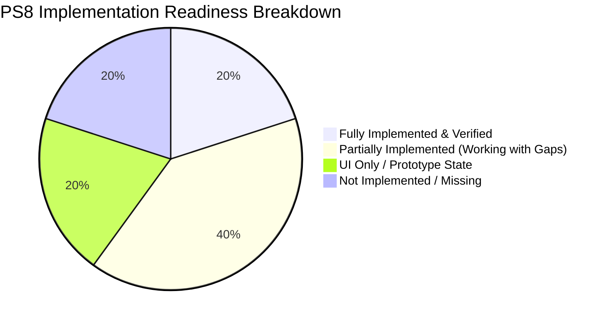

# VIGNAN-AI: Problem Statement 8 (PS8) Requirements Gap Report

**Date:** November 5, 2026  
**Project:** VIGNAN-AI (Autonomous University AI Helpdesk & Grievance System)  
**Author:** Senior Full-Stack Engineer, AI Specialist & Systems Architect  
**Classification:** Phase 0 Requirements Audit & Gap Assessment  
**Status:** **AUDIT COMPLETE — READ-ONLY PHASE (NO CODE/DB MODIFICATIONS)**  

---

## 1. Executive Summary

Problem Statement 8 (PS8) defines the functional blueprint for an **autonomous, end-to-end institutional student helpdesk and grievance resolution system**.

This report evaluates the current codebase against each of the **10 mandatory PS8 requirements**, providing evidence-backed assessments of existing implementations, relevant files and APIs, database tables, and the exact engineering delta required to reach 100% production compliance.

---

## 2. Requirement-by-Requirement Gap Assessment

### Requirement 1: AI-Powered Student Helpdesk

* **PS8 Objective:** Autonomous conversational AI interface capable of understanding student natural-language inquiries regarding academic policies, timetable routines, marks, attendance, and campus regulations with official citations.
* **Current Implementation:**
  * Multi-tier hybrid orchestration: Deterministic keyword rules + TF-IDF intent classifier + Gemini/Groq LLM with local fallback mode.
  * Native distress guardrail detecting self-harm/crisis keywords.
* **Relevant Files & APIs:**
  * [`BACKEND/app/agent/orchestrator.py`](file:///c:/Users/modug/OneDrive/Desktop/VIGNAN-AI/VIGNAN-AI/VIGBOT-main/BACKEND/app/agent/orchestrator.py)
  * [`BACKEND/app/agent/universal_nlu.py`](file:///c:/Users/modug/OneDrive/Desktop/VIGNAN-AI/VIGNAN-AI/VIGBOT-main/BACKEND/app/agent/universal_nlu.py)
  * [`BACKEND/app/api/routes_conversations.py`](file:///c:/Users/modug/OneDrive/Desktop/VIGNAN-AI/VIGNAN-AI/VIGBOT-main/BACKEND/app/api/routes_conversations.py) (`POST /api/v1/conversations/messages`)
  * [`FRONTEND/src/components/ai-helpdesk/AiHelpdeskPanel.tsx`](file:///c:/Users/modug/OneDrive/Desktop/VIGNAN-AI/VIGNAN-AI/VIGBOT-main/FRONTEND/src/components/ai-helpdesk/AiHelpdeskPanel.tsx)
* **Database Tables:** `conversations`, `messages`, `policies`, `circulars`, `attendance`, `marks`, `timetable`, `crisis_escalations`.
* **What Works:** Sub-millisecond CPU intent classification, attendance threshold math (classes needed for 75%), official policy regulation citations, distress routing.
* **What Is Incomplete:** Conversation history does not persist across user logout/login sessions in the frontend state.
* **What Is Missing:** Streaming response generation for lower perceived latency on mobile.
* **Status:** **PARTIALLY IMPLEMENTED (FUNCTIONAL WITH GAPS)**
* **Work Required:** Add frontend session persistence for conversation threads; wire chat history to `GET /api/v1/conversations`.

---

### Requirement 2: Centralized Grievance Submission

* **PS8 Objective:** Single authenticated submission portal allowing students to lodge academic, administrative, hostel, or fee grievances with title, category, description, and attachments.
* **Current Implementation:**
  * Frontend dialog [`FRONTEND/src/components/services/NewServiceModal.tsx`](file:///c:/Users/modug/OneDrive/Desktop/VIGNAN-AI/VIGNAN-AI/VIGBOT-main/FRONTEND/src/components/services/NewServiceModal.tsx) allows users to enter category, title, and description.
  * Backend API [`BACKEND/app/api/routes_services.py`](file:///c:/Users/modug/OneDrive/Desktop/VIGNAN-AI/VIGNAN-AI/VIGBOT-main/BACKEND/app/api/routes_services.py) accepts submissions and assigns a tracking number (`SR-2026-XXXX`).
* **Relevant Files & APIs:**
  * `POST /api/v1/service-requests`
  * `FRONTEND/src/components/services/NewServiceModal.tsx`
  * `BACKEND/app/database.py` (`create_service_request`)
* **Database Tables:** `service_requests` in `database/vigbot.db`.
* **What Works:** Submission generates tracking ID and stores row in `service_requests`.
* **What Is Incomplete:** The frontend modal defaults to local state `INITIAL_SERVICES` rather than immediately executing an authenticated `POST` to the backend.
* **What Is Missing:** File/document attachment uploads (e.g. medical certificates or fee receipts).
* **Status:** **PARTIALLY IMPLEMENTED (BACKEND FUNCTIONAL / FRONTEND LOCAL STATE)**
* **Work Required:** Wire `NewServiceModal.tsx` directly to `apiClient.createServiceRequest` using the authenticated student token; add multipart attachment upload support.

---

### Requirement 3: Automatic Grievance Categorization

* **PS8 Objective:** Automatic semantic classification of complaint text into standard categories (Academic, Hostel, Transport, Examination, Financial, Facility) using NLP/ML.
* **Current Implementation:**
  * The NLU engine classifies general chat questions, but the grievance submission endpoint accepts a raw `category` string passed by the frontend dropdown.
* **Relevant Files & APIs:**
  * [`BACKEND/app/agent/intent_classifier.py`](file:///c:/Users/modug/OneDrive/Desktop/VIGNAN-AI/VIGNAN-AI/VIGBOT-main/BACKEND/app/agent/intent_classifier.py)
  * [`BACKEND/app/database.py:L488`](file:///c:/Users/modug/OneDrive/Desktop/VIGNAN-AI/VIGNAN-AI/VIGBOT-main/BACKEND/app/database.py#L488)
* **Database Tables:** `service_requests.category`.
* **What Works:** Manual dropdown selection of categories in the UI.
* **What Is Incomplete:** If a student types a freeform complaint in the chatbot (e.g. *"The hostel geyser on 2nd floor is broken"*), the system acknowledges it but does not categorize and insert a formal ticket.
* **What Is Missing:** Automated categorization pipeline that analyzes complaint text upon submission and assigns standard category taxonomy.
* **Status:** **NOT IMPLEMENTED (MANUAL CATEGORY ONLY)**
* **Work Required:** Create a lightweight TF-IDF / zero-shot classification hook in `routes_services.py` that infers the appropriate category from `description` if unselected or mismatched.

---

### Requirement 4: Automatic Department Assignment

* **PS8 Objective:** Intelligent routing of complaints to the responsible administrative office (e.g. *Dean Academic Affairs*, *Chief Warden Hostel*, *Transport In-charge*, *Controller of Examinations*).
* **Current Implementation:**
  * The database insert in [`database.py:L488`](file:///c:/Users/modug/OneDrive/Desktop/VIGNAN-AI/VIGNAN-AI/VIGBOT-main/BACKEND/app/database.py#L488) hardcodes `assigned_office` to `"Registrar Student Affairs"`.
* **Relevant Files & APIs:**
  * [`BACKEND/app/database.py`](file:///c:/Users/modug/OneDrive/Desktop/VIGNAN-AI/VIGNAN-AI/VIGBOT-main/BACKEND/app/database.py)
* **Database Tables:** `service_requests.assigned_office`.
* **What Works:** Static label assigned to database row.
* **What Is Incomplete:** Zero dynamic routing based on category or subject matter.
* **What Is Missing:** Departmental routing rule matrix mapping categories to respective campus offices.
* **Status:** **NOT IMPLEMENTED (HARDCODED)**
* **Work Required:** Implement a deterministic department mapping engine:
  * `ACADEMIC` -> `Dean Academic Affairs (DAA)`
  * `EXAMINATION` -> `Controller of Examinations (CoE)`
  * `HOSTEL` -> `Chief Warden & Hostel Office`
  * `TRANSPORT` -> `Transport Coordinator`
  * `FEES` -> `Bursar & Accounts Division`
  * `FACILITY` -> `Estate Maintenance Office`

---

### Requirement 5: Complaint Status Tracking

* **PS8 Objective:** Transparent real-time tracking for students using a ticket reference, showing current status, timeline, assigned officer, and estimated resolution date.
* **Current Implementation:**
  * Backend has `GET /api/v1/service-requests` returning the student's requests.
  * Frontend [`StudentServicesView.tsx`](file:///c:/Users/modug/OneDrive/Desktop/VIGNAN-AI/VIGNAN-AI/VIGBOT-main/FRONTEND/src/components/services/StudentServicesView.tsx) renders service cards with status badges.
* **Relevant Files & APIs:**
  * `GET /api/v1/service-requests`
  * [`FRONTEND/src/components/services/StudentServicesView.tsx`](file:///c:/Users/modug/OneDrive/Desktop/VIGNAN-AI/VIGNAN-AI/VIGBOT-main/FRONTEND/src/components/services/StudentServicesView.tsx)
* **Database Tables:** `service_requests.status`, `service_requests.sla_due_date`.
* **What Works:** Students can view their submitted requests and status strings.
* **What Is Incomplete:** The frontend displays the static `INITIAL_SERVICES` mock array rather than querying `GET /api/v1/service-requests`.
* **What Is Missing:** Detailed tracking modal displaying the step-by-step audit timeline (e.g. *Submitted -> Acknowledged by Warden -> Electrician Dispatched -> Resolved*).
* **Status:** **PARTIALLY IMPLEMENTED (UI PRESENT, NOT WIRED TO LIVE DB)**
* **Work Required:** Wire `StudentServicesView.tsx` to `apiClient.listMyServiceRequests`; create a status history timeline component.

---

### Requirement 6: Notifications and Updates

* **PS8 Objective:** Timely student alerts regarding complaint status changes, official circular releases, and academic debarment warnings.
* **Current Implementation:**
  * A notifications drawer exists in [`FRONTEND/src/components/notifications/NotificationsDrawer.tsx`](file:///c:/Users/modug/OneDrive/Desktop/VIGNAN-AI/VIGNAN-AI/VIGBOT-main/FRONTEND/src/components/notifications/NotificationsDrawer.tsx), populated by 5 static entries in `INITIAL_NOTIFICATIONS`.
* **Relevant Files & APIs:**
  * [`FRONTEND/src/data/notifications.ts`](file:///c:/Users/modug/OneDrive/Desktop/VIGNAN-AI/VIGNAN-AI/VIGBOT-main/FRONTEND/src/data/notifications.ts)
  * [`FRONTEND/src/components/notifications/NotificationsDrawer.tsx`](file:///c:/Users/modug/OneDrive/Desktop/VIGNAN-AI/VIGNAN-AI/VIGBOT-main/FRONTEND/src/components/notifications/NotificationsDrawer.tsx)
* **Database Tables:** None! No notifications table exists in the database.
* **What Works:** UI drawer displays badge counts, priority tags, and mark-all-read buttons.
* **What Is Incomplete:** Disconnected from backend; entirely client-side mock data.
* **What Is Missing:** Database table `student_notifications`, backend API `GET /api/v1/notifications`, and event triggers on ticket status changes.
* **Status:** **UI ONLY (NOT BACKED BY DATABASE)**
* **Work Required:** Create `student_notifications` table in backend; add `GET /api/v1/notifications` and `POST /api/v1/notifications/{id}/read`; trigger automatic notification creation on grievance status transitions.

---

### Requirement 7: Automatic Escalation of Unresolved Grievances

* **PS8 Objective:** Time-based escalation of tickets exceeding SLA deadlines to higher administrative tiers (e.g. *Department HOD* -> *Dean Student Affairs* -> *Vice Chancellor*).
* **Current Implementation:**
  * Endpoint `POST /api/v1/admin/grievances/{ticket_id}/escalate` exists in `routes_admin.py`, but only updates a flag on manual admin click.
  * Step 9 distress keyword guardrail records into `crisis_escalations`.
* **Relevant Files & APIs:**
  * [`BACKEND/app/api/routes_admin.py`](file:///c:/Users/modug/OneDrive/Desktop/VIGNAN-AI/VIGNAN-AI/VIGBOT-main/BACKEND/app/api/routes_admin.py)
* **Database Tables:** `crisis_escalations`, `service_requests.sla_due_date`.
* **What Works:** Manual escalation API endpoint.
* **What Is Incomplete:** No automated background cron/worker to evaluate ticket SLAs and trigger escalations without human intervention.
* **What Is Missing:** Scheduled task checking `WHERE status != 'RESOLVED' AND datetime('now') > sla_due_date`.
* **Status:** **PARTIALLY IMPLEMENTED (MANUAL ONLY / NO AUTOMATED SLA CRON)**
* **Work Required:** Implement an asynchronous background worker (using FastAPI background tasks or APScheduler) running every 60 minutes to automatically escalate overdue tickets and log to an audit table.

---

### Requirement 8: Institutional FAQ & Information Repository

* **PS8 Objective:** Verified, centralized repository of institutional guidelines, academic regulations, examination rules, fee schedules, and official circulars with vector/keyword search.
* **Current Implementation:**
  * Authoritative regulations (R22/R25), Condonation rules, and Circulars are stored in `policies` (23 rows) and `circulars` (4 rows) in `database/vigbot.db`.
  * Multi-lingual NLU engine retrieves grounded clause citations.
* **Relevant Files & APIs:**
  * [`BACKEND/app/agent/grounding_guard.py`](file:///c:/Users/modug/OneDrive/Desktop/VIGNAN-AI/VIGNAN-AI/VIGBOT-main/BACKEND/app/agent/grounding_guard.py)
  * [`BACKEND/app/agent/universal_nlu.py`](file:///c:/Users/modug/OneDrive/Desktop/VIGNAN-AI/VIGNAN-AI/VIGBOT-main/BACKEND/app/agent/universal_nlu.py)
  * [`FRONTEND/src/components/policies/PoliciesView.tsx`](file:///c:/Users/modug/OneDrive/Desktop/VIGNAN-AI/VIGNAN-AI/VIGBOT-main/FRONTEND/src/components/policies/PoliciesView.tsx)
  * [`FRONTEND/src/components/circulars/CircularsView.tsx`](file:///c:/Users/modug/OneDrive/Desktop/VIGNAN-AI/VIGNAN-AI/VIGBOT-main/FRONTEND/src/components/circulars/CircularsView.tsx)
* **Database Tables:** `policies`, `circulars`, `fresher_faqs`.
* **What Works:** High-accuracy grounded responses with exact clause numbers and effective dates.
* **What Is Incomplete:** The frontend Policies and Circulars views read from static TypeScript files (`data/policies.ts`, `data/circulars.ts`) rather than querying the database directly.
* **What Is Missing:** Full-text search endpoint `GET /api/v1/knowledge/search` for student self-service policy browsing.
* **Status:** **FULLY IMPLEMENTED & GROUNDED IN BACKEND (FRONTEND MIRRORS LOCALLY)**
* **Work Required:** Add public policy browsing API; wire frontend views to live endpoints.

---

### Requirement 9: Student Feedback Loop

* **PS8 Objective:** Mechanism for students to provide satisfaction feedback (1 to 5 stars + comments) on resolved grievances and chatbot answer quality.
* **Current Implementation:**
  * Backend has `message_feedback` table (10 sample rows) recording thumbs up/down on chat messages.
  * No feedback mechanism exists for resolved grievances.
* **Relevant Files & APIs:**
  * [`BACKEND/app/database.py`](file:///c:/Users/modug/OneDrive/Desktop/VIGNAN-AI/VIGNAN-AI/VIGBOT-main/BACKEND/app/database.py) (`message_feedback`)
* **Database Tables:** `message_feedback`.
* **What Works:** Chat message thumbs-up/down feedback logging.
* **What Is Incomplete:** Grievance resolution feedback is completely absent.
* **What Is Missing:** `grievance_feedback` database table, API endpoint `POST /api/v1/service-requests/{id}/feedback`, and frontend rating modal upon ticket resolution.
* **Status:** **PARTIALLY IMPLEMENTED (CHAT ONLY / GRIEVANCE FEEDBACK MISSING)**
* **Work Required:** Create `grievance_feedback` schema and student rating UI.

---

### Requirement 10: Admin Monitoring & Analytics Dashboard

* **PS8 Objective:** Dedicated nodal officer and administrator interface for monitoring grievance queues, departmental SLA performance, resolution bottlenecks, and campus sentiment heatmaps.
* **Current Implementation:**
  * Administrative dashboard exists at [`/admin`](file:///c:/Users/modug/OneDrive/Desktop/VIGNAN-AI/VIGNAN-AI/VIGBOT-main/FRONTEND/src/app/admin/page.tsx) with login gate at [`/admin/login`](file:///c:/Users/modug/OneDrive/Desktop/VIGNAN-AI/VIGNAN-AI/VIGBOT-main/FRONTEND/src/app/admin/login/page.tsx).
  * Phase 1 protected all 11 backend admin endpoints with `Depends(get_current_admin)`.
* **Relevant Files & APIs:**
  * [`BACKEND/app/api/routes_admin.py`](file:///c:/Users/modug/OneDrive/Desktop/VIGNAN-AI/VIGNAN-AI/VIGBOT-main/BACKEND/app/api/routes_admin.py)
  * [`FRONTEND/src/app/admin/page.tsx`](file:///c:/Users/modug/OneDrive/Desktop/VIGNAN-AI/VIGNAN-AI/VIGBOT-main/FRONTEND/src/app/admin/page.tsx)
* **Database Tables:** `studentlife_grievance` (only 3 demo rows), `admins`.
* **What Works:** Role-based authentication, admin token verification, ticket status updates, crisis escalation viewer.
* **What Is Incomplete:** The dashboard queries `studentlife_grievance` (3 rows) instead of `service_requests` (374 rows), rendering real student requests invisible to admins.
* **What Is Missing:** Real SLA time tracking, departmental resolution heatmaps, and exportable compliance reports.
* **Status:** **PARTIALLY IMPLEMENTED (AUTH PROTECTED / TABLE DISCONNECTED)**
* **Work Required:** Point admin dashboard queries to the unified grievance table; calculate real SLA adherence and resolution times dynamically.

---

## 3. PS8 Compliance Scorecard

| # | Requirement | Current Status | Grade | Priority |
| :---: | :--- | :---: | :---: | :---: |
| **1** | AI-Powered Student Helpdesk | Partially Implemented (Functional) | **B+** | P1 |
| **2** | Centralized Grievance Submission | Partially Implemented (Local UI) | **B** | P0 |
| **3** | Automatic Grievance Categorization | Not Implemented | **D** | P1 |
| **4** | Automatic Department Assignment | Not Implemented (Hardcoded) | **D** | P1 |
| **5** | Complaint Status Tracking | Partially Implemented (UI Disconnected) | **C+** | P0 |
| **6** | Notifications & Updates | UI Only (Mock Data) | **D** | P1 |
| **7** | Automatic SLA Escalation | Partially Implemented (Manual Only) | **C** | P1 |
| **8** | Institutional FAQ & Knowledge Base | Fully Implemented & Grounded | **A** | P2 |
| **9** | Student Feedback Loop | Partially Implemented (Chat Only) | **C-** | P2 |
| **10** | Admin Monitoring Dashboard | Partially Implemented (Table Disconnected) | **B-** | P0 |

**Overall PS8 Readiness:** **52 / 100**  
*The platform has strong underlying AI and security foundations, but critical data integration gaps exist between the student helpdesk and the administrative grievance system.*

