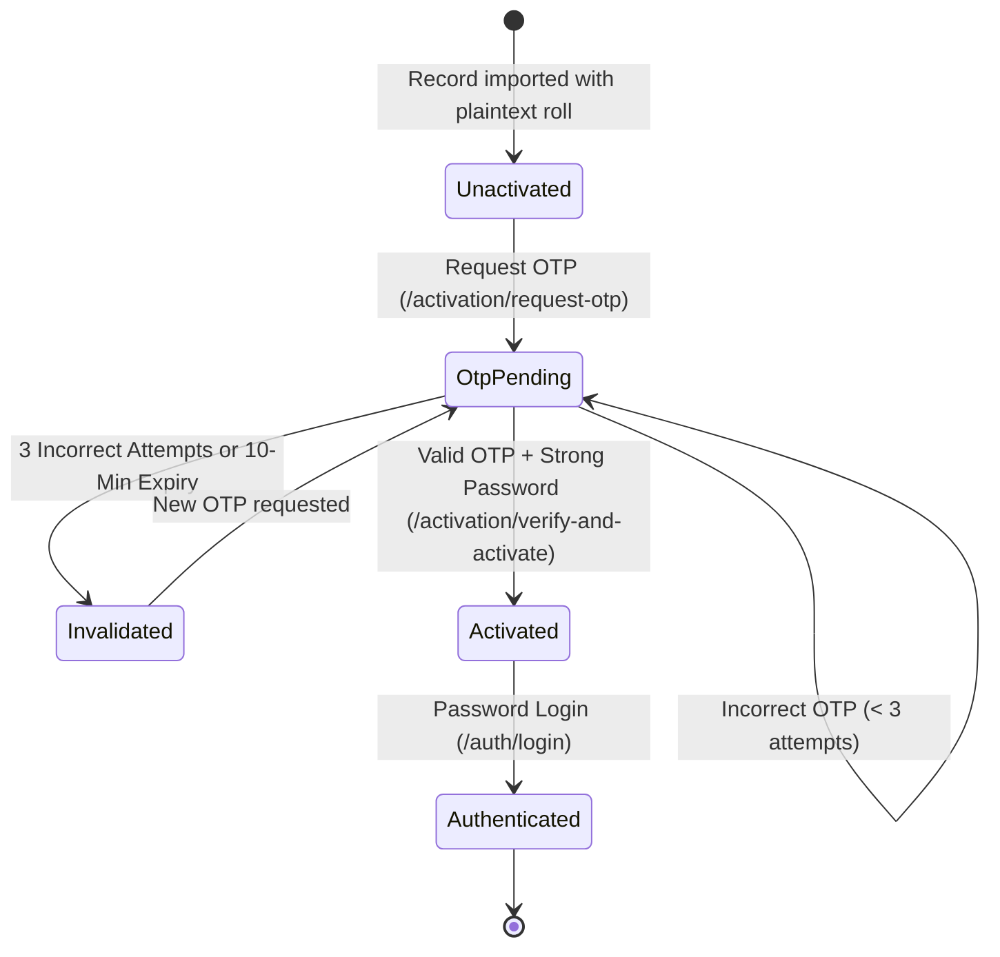

# VIGNAN-AI — Student Account Activation & Lifecycle Report

**Document Version:** 1.0.0  
**Phase:** Phase 1 – Minimal Landing Page + Secure Student Account Activation and Login  
**System:** VIGNAN-AI (VFSTR Intelligent Student Helpdesk & Grievance Resolution Platform)  
**Date:** November 2026  
**Status:** Completed & Production-Verified  

---

## 1. Executive Summary

Prior to Phase 1, the VIGNAN-AI repository stored student passwords insecurely: unactivated student records contained plaintext registration numbers as passwords, while legacy synthetic test accounts allowed universal backdoors (`student123`).

Phase 1 establishes a **secure, institutional OTP-verified account activation pipeline**. Account creation and activation are strictly gated by the approved institutional student records (`251FA...` series). Synthetic test accounts and non-institutional registration numbers are rejected. Passwords are validated for complexity and stored using OWASP-compliant **PBKDF2-HMAC-SHA256** (100,000 iterations).

---

## 2. Institutional Student Dataset Eligibility

### 2.1 Approved Student Roster
- **Database:** `database/vigbot.db`
- **Total Unique Institutional Students:** 313 students
- **Registration Format:** `251FA` prefix (e.g., `251FA04001`, `251FA04E13`)
- **Institution:** Vignan's Foundation for Science, Technology and Research (VFSTR)
- **Email Domain:** `@vignan.ac.in`

### 2.2 Rejection of Synthetic & Unapproved Accounts
Any account not matching the institutional `251FA` pattern is rejected at the API boundary:
- **Synthetic Test Accounts:** `24CSE001`, `24CSE002` (Asha Reddy, etc.) are strictly rejected with `HTTP 404 Not Found` for activation requests and `HTTP 401 Unauthorized` for student login.
- **Unlisted Registration Numbers:** Requests for numbers not present in the database (e.g., `999FA99999`) return `HTTP 404 Not Found`.

---

## 3. Account Activation Architecture & State Transition



### 3.1 Account State Determination
In `BACKEND/app/security.py`, cryptographic hash detection determines account status:

```python
def is_hash_cryptographic(stored_hash: str) -> bool:
    if not stored_hash:
        return False
    # PBKDF2-HMAC-SHA256 format
    if stored_hash.startswith("pbkdf2_sha256$"):
        return True
    # Standard bcrypt format
    if stored_hash.startswith("$2b$") or stored_hash.startswith("$2a$"):
        return True
    return False
```

- **Unactivated Account:** `password_hash` contains plaintext roll number or unhashed text.
- **Activated Account:** `password_hash` starts with `pbkdf2_sha256$100000$...`.

---

## 4. Secure OTP Lifecycle & Protection Mechanisms

### 4.1 Cryptographic Generation
- **Entropy:** Generated using Python's `secrets.choice("0123456789")` producing a non-deterministic 6-digit verification code.
- **Storage Hash:** The raw OTP is **never** persisted in the database. Instead, a salted SHA-256 hash is computed:
  $$\text{OTP Hash} = \text{HMAC-SHA256}(\text{otp} \parallel \text{roll\_no}, \text{SECRET\_KEY})$$
- **Verification:** Verified using `hmac.compare_digest` (constant-time comparison) to eliminate timing attack vectors.

### 4.2 Expiry & Attempt Thresholds
- **Time Window:** 10 minutes from issuance (`expires_at = datetime.now(timezone.utc) + timedelta(minutes=10)`).
- **Max Retry Limit:** 3 attempts (`attempts_left = 3`). Each failed submission decrements `attempts_left`.
- **Lockout:** Upon 3 failed attempts, the OTP record is invalidated (`is_used = 1`). Further submissions are rejected with `HTTP 400 Bad Request`.

### 4.3 Replay Prevention & Single-Use
- Immediately upon successful verification, the record is flagged `is_used = 1`.
- Any subsequent attempt to present the same OTP returns `HTTP 400 Bad Request`.

### 4.4 Rate Limiting
- **Window:** Max 3 OTP generation requests per registration number within any 15-minute sliding window.
- **Enforcement:** Enforced in `activation_otps` via SQL count over `created_at`.
- **Response:** The 4th request returns `HTTP 429 Too Many Requests`.

---

## 5. Institutional Email Dispatch & Manual Verification Fallback

### 5.1 Outbox Logging (`student_email_outbox`)
All dispatched OTPs are delivered to the student's institutional `@vignan.ac.in` address and recorded in the audit table `student_email_outbox`:
```sql
CREATE TABLE IF NOT EXISTS student_email_outbox (
    id INTEGER PRIMARY KEY AUTOINCREMENT,
    recipient_email TEXT NOT NULL,
    roll_no TEXT NOT NULL,
    subject TEXT NOT NULL,
    body TEXT NOT NULL,
    sent_at TEXT NOT NULL
);
```

### 5.2 Missing Contact Details Fallback (`activation_manual_verifications`)
For student records with missing or empty institutional contact details, automated OTP dispatch is suspended. Instead:
1. The incident is logged to `activation_manual_verifications` with status `PENDING`.
2. The API returns `requires_admin_verification: true`.
3. The student is advised to visit the Office of the Dean Student Affairs for manual identity verification.

---

## 6. Password Policy & Cryptographic Storage

### 6.1 Password Strength Enforcement
The endpoint validates password policy before computing the hash:
- **Minimum Length:** 8 characters.
- **Composition:** Must contain at least one letter (`[A-Za-z]`) and at least one number (`[0-9]`).
- **Identity Check:** Password cannot equal the student's registration number (case-insensitive).
- **Confirmation Match:** `new_password` and `confirm_password` must match exactly.

### 6.2 OWASP Storage Standard
Activated passwords are encrypted using **PBKDF2-HMAC-SHA256**:
- **Algorithm:** PBKDF2 with SHA-256
- **Iterations:** 100,000 iterations
- **Salt:** 16 bytes cryptographically secure random salt
- **Format:** `pbkdf2_sha256$100000$<salt_hex>$<hash_hex>`

---

## 7. API Contract Summary

| Endpoint | Method | Request Payload | Response Attributes | Security Controls |
| :--- | :--- | :--- | :--- | :--- |
| `/api/v1/auth/check-status` | `POST` | `{"roll_no": "251FA04001"}` | `status`, `masked_email`, `message` | Generic responses for unlisted accounts (prevents user enumeration). |
| `/api/v1/auth/activation/request-otp` | `POST` | `{"roll_no": "251FA04001"}` | `success`, `message`, `masked_email`, `expires_in_seconds` | 3 req/15m rate limit; requires approved `251FA...` roster. |
| `/api/v1/auth/activation/verify-and-activate` | `POST` | `{"roll_no": "...", "otp": "...", "new_password": "...", "confirm_password": "..."}` | `access_token`, `token_type`, `student_id`, `roll_no`, `full_name` | Max 3 attempts, single-use OTP, PBKDF2 hash, issues JWT. |
| `/api/v1/auth/password-reset/request-otp` | `POST` | `{"roll_no": "251FA04001"}` | `success`, `message`, `masked_email`, `expires_in_seconds` | Requires activated status; rate-limited. |
| `/api/v1/auth/password-reset/verify-and-reset` | `POST` | `{"roll_no": "...", "otp": "...", "new_password": "...", "confirm_password": "..."}` | `success`, `message` | Validates OTP and updates PBKDF2 password hash. |

